# Viz native cohort setup

This private CI library prepares existing workspace gates from two admitted original source archives.
The Node22/24 workflow now uses those fixed source-only inputs. Actual fresh gate results and review
are still required; producer admission is not consumer compatibility or registry readiness.

`manifests.mjs` owns exactly four temporary dependency-slot projections: root engine14.0.0-rc.0 and
Foottrace2.1.0 exact requests, AF's root development request and Studio's existing `storydeck` key.
The exact registry requests prevent a newer release admitted by the authored caret ranges from entering
this fixed validation cohort. The Storydeck projection explicitly replaces alias resolution during
native setup; it does not rename the original `footprint-storydeck` archive. Other fields, workspace
privacy and original input bytes are preserved. The owning setup workflow must retain and restore the
exact authored caret ranges and all original bytes/modes, including after installation failure.

```mermaid
flowchart LR
  fetch[FETCH: token-only public metadata + original ZIP data] --> admit[Fixed provider/head/tree/parent/gate/archive admission]
  admit --> prepare[PREPARE: no API token; re-admit saved originals]
  prepare --> lock[Baseline-derived four-name lock update + strict original-hook ci]
  lock --> guard[Actual members / all physical owners / compiler / locks]
  guard --> restore[Restore immutable Git manifest + public-lock bytes and modes]
  restore --> gates[Existing build / types / browser / two 100% gates]
  gates --> verify[VERIFY: re-admit original archives + prior-step checkpoint + installed guard]
```

`admission.mjs` owns fixed provider/receipt semantics; `zip_input.py` owns the original-ZIP boundary;
`transport.mjs` owns read-only provider/data capture and saved-data re-admission; `manifests.mjs` owns
the four projections; `installed.mjs` owns physical/member/lock/compiler observations; `setup.mjs` owns
the fixed setup/restoration transaction. Only `scripts/native-cohort.mjs` may wire these private units.
No downloaded package or helper runs during FETCH. The shared pinned ci1ca inspector owns tar parsing.
Its existing AF roots include CAPABILITIES.md and canonical-notes.json; Storydeck keeps its own profile.

The workflow gives `GH_TOKEN` ONLY to FETCH. PREPARE and VERIFY require its absence, re-admit saved
ZIP/receipt/TGZ bytes against fixed `inputs.json`, and never call a GitHub client. PREPARE starts from
the genuine historical public lock, updates only agentfootprint/storydeck/footprintjs/foottrace requests,
preserves the vendored context0.1.0/compiler entries, then uses strict ordinary ci and its prepare hook.
Both context0.1.0 and AF's context0.1.1 are observed. Hidden directories, alias package manifests, bin links
and workspace links are inspected; installed dependency namespaces are separately recorded, not shipped
archive members. Installed source-package members equal their original archives; other family/compiler
images are fingerprinted after normal strict installation and must remain unchanged through the gates.
The literal workspace declarations must match this closed four-manifest cohort. Every root/workspace
`node_modules` scope is examined independently; absent scopes are empty, and every present canonical
directory is visited once. Workspace symlinks do not replace those scans. Hidden aliases/locks in any
scope participate, and declared local bin links may target any admitted dependency scope. Unknown
workspace declarations or linked dependency namespaces refuse rather than imply a complete census.
Every phase and the CLI first require `GITHUB_ACTIONS=true` and the exact
`GITHUB_REPOSITORY=footprintjs/vizfootprint`; desktop and foreign-repository invocations refuse before I/O.

PREPARE emits `checkpoint_sha256` as a GitHub step output. VERIFY requires the immutable prior-step
output as `EXPECTED_NATIVE_CHECKPOINT`; a digest stored beside the mutable checkpoint is never trusted.
Authored source bytes/modes are re-read from consumer GitHEAD independently of backups/checkpoints.
Restoration runs on setup failures too and reports restoration failure separately. An uncertain setup
is consumed, not retried in place. No alternate credentials, dependency overrides or peer bypass exists.

Evidence upload whitelists compact admissions, original/projected manifests and hashes, native
lock, command result/log records, restoration and final inventory/checkpoint observations. Never upload
the whole scratch folder, npm cache, duplicate producer ZIP/TGZ, build tree or node_modules. Owned input
and cache cleanup follows the LAST required guard; public source, historical lock and canonical producer
evidence remain intact. Local source authoring never installs, builds or packs these inputs. Hosted
execution validates source inputs; registry publication and public-lock readiness remain separate.

Focused inert checks: `node --test scripts/native-cohort/*.node-test.mjs` with `NATIVE_ARCHIVE_PORT`
pointing to the pinned shared archive directory, plus `python3 -B -m unittest discover -s
scripts/native-cohort -p '*_test.py'`. They install, build or execute no package.
